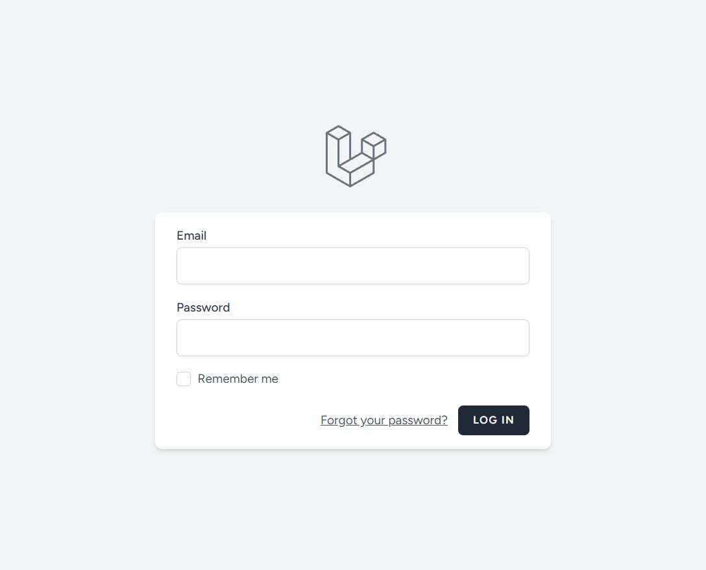
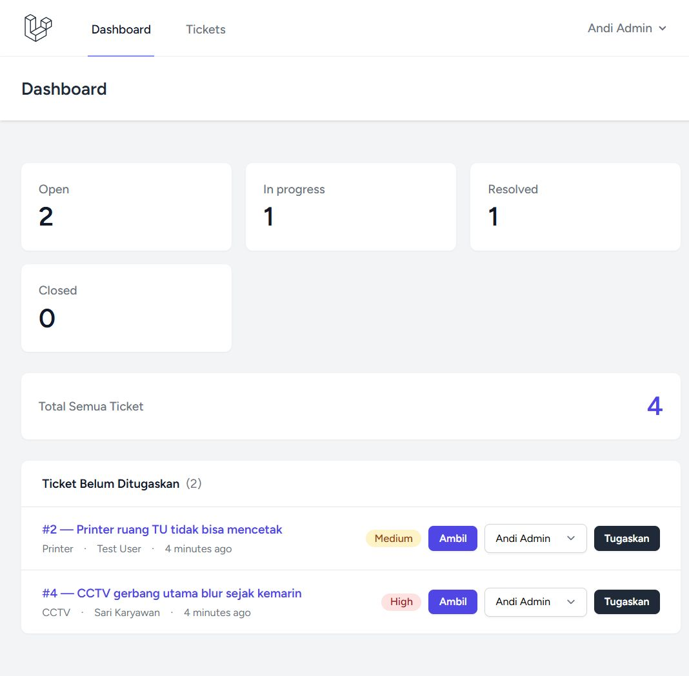
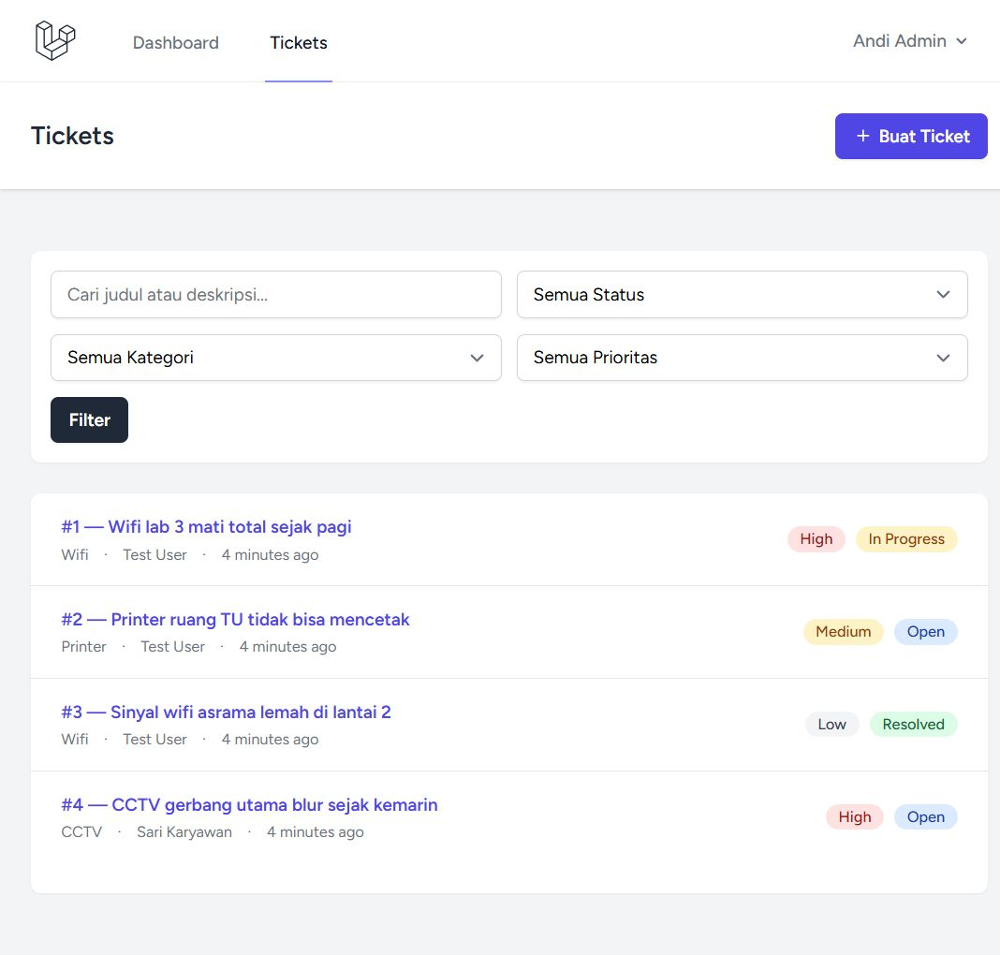
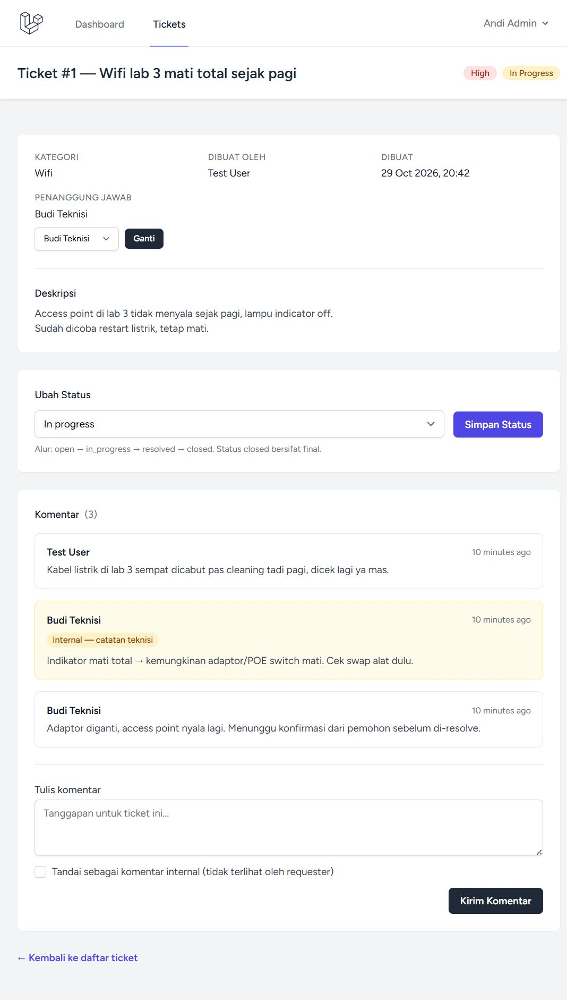
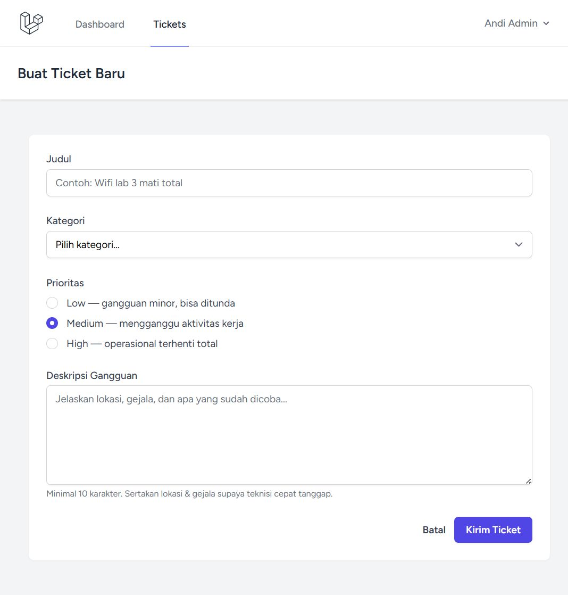
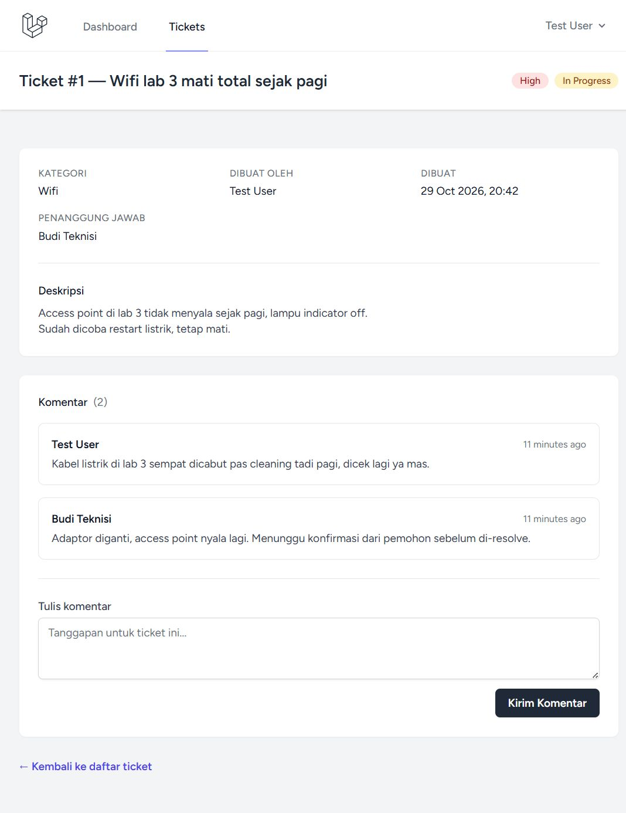

# IT Ticketing System

An internal helpdesk application for reporting and tracking IT disturbances — Wi-Fi outages, printer errors, broken CCTV, and more.

> **Why this project?** During my IT support internship, incident reports arrived through WhatsApp threads. Issues got lost, ownership was unclear, and there was no record of what was fixed. This app turns that chaos into a structured workflow: every incident becomes a ticket with a category, a priority, an owner, and a visible status.

**Tech stack:** Laravel 13 · PHP 8.4 · MySQL · Blade · Tailwind CSS · Laravel Breeze · PHPUnit

---

## Features

### Core (MVP)
- **Authentication** — register & login via Laravel Breeze
- **Role-based access control** — `user`, `technician`, `admin`, enforced through Laravel Policies (no manual role checks scattered through views)
- **Ticket CRUD** — users create tickets; technicians/admins see all tickets
- **Categories** — fixed reference data, seeded (Wi-Fi, CCTV, Printer, LAN, Laptop, Projector, Other)
- **Priority levels** — `low`, `medium`, `high` with visual badges
- **Status workflow** — `open → in_progress → resolved → closed`, where **closed is final** (enforced in `TicketPolicy`)
- **Comments** — public comments for requester–technician communication, plus **internal notes visible only to staff**
- **Search & filters** — by keyword (title/description), status, category, and priority, combined with pagination
- **Dashboard** — status counts (single `GROUP BY` query) and an unassigned-ticket queue
- **Ticket assignment** — technicians **claim** unassigned tickets; admins **assign/reassign** to any staff member
- **Demo seed data** — ready-to-explore accounts and realistic sample tickets

### Security
- Authorization centralized in `TicketPolicy` (view, create, update, viewInternal, viewAll, assign, claim)
- Server-side validation via Form Requests on every write endpoint
- Internal comments filtered server-side — requesters never see them, not even the comment count
- Mass-assignment protection: sensitive fields (`status`, `assigned_to`, `user_id`) are intentionally **not** fillable and are set explicitly
- CSRF protection on all forms, parameterized queries via Eloquent, `enum`-validated status values
- No hardcoded credentials — everything via `.env`

## Screenshots

| | |
|---|---|
|  |  |
| **Login** | **Dashboard (admin)** — status stats + unassigned queue |
|  |  |
| **Ticket list** — search & filters | **Ticket detail (staff)** — status form, assignment, internal notes |
|  |  |
| **Create ticket** | **Ticket detail (user)** — internal notes hidden |

## Roles

| Capability | User | Technician | Admin |
|---|:-:|:-:|:-:|
| Create ticket, comment publicly | ✅ | ✅ | ✅ |
| View own tickets | ✅ | — | — |
| View all tickets | — | ✅ | ✅ |
| Update status (until closed) | — | ✅ | ✅ |
| Claim unassigned ticket | — | ✅ | ✅ |
| Assign / reassign ticket | — | — | ✅ |
| View & write internal notes | — | ✅ | ✅ |
| Dashboard stats & queue | own tickets | ✅ | ✅ |

## Tech Stack & Versions

| Component | Version |
|---|---|
| Laravel | 13.39.0 |
| PHP | 8.4 |
| MySQL | 8.x (XAMPP) — tests run on SQLite in-memory |
| Laravel Breeze | 2.4.2 (Blade stack) |
| Laravel Boost | 2.10.4 (AI coding guidelines) |
| Tailwind CSS | v4 (via Vite) |
| PHPUnit | 12.x |

## Installation

**Prerequisites:** PHP 8.4+, Composer, Node.js, MySQL.

```bash
git clone https://github.com/compavel/it-ticketing.git
cd it-ticketing
composer install
npm install
```

### Environment configuration

```bash
cp .env.example .env
php artisan key:generate
```

Set your database credentials in `.env`:

```env
DB_CONNECTION=mysql
DB_HOST=127.0.0.1
DB_PORT=3306
DB_DATABASE=it_ticketing
DB_USERNAME=root
DB_PASSWORD=
```

> On my setup MySQL runs on port **3307** (XAMPP custom port) — adjust `DB_PORT` to match yours.

### Database setup

```bash
php artisan migrate
php artisan db:seed   # categories + demo tickets/comments
```

### Build assets & run

```bash
npm run build         # or: npm run dev (watch mode)
php artisan serve     # http://127.0.0.1:8000
```

## Demo Credentials

All accounts use password: **`password`**

| Role | Email |
|---|---|
| User (requester) | `test@example.com` |
| Technician | `technician@example.com` |
| User (other tickets) | `sari@example.com` |
| Admin | `admin@example.com` |

## Testing

```bash
php artisan test              # full suite
php artisan test --compact    # compact output
```

**68 tests, 181 assertions** — covering authentication, CRUD, authorization boundaries for all three roles, validation, status workflow rules (including closed-is-final), comment visibility (internal notes hidden from requesters, counts not leaked), assignment/claim rules, and dashboard scoping.

Tests run against in-memory SQLite, so no database server is needed.

Code style:

```bash
vendor/bin/pint               # format everything
vendor/bin/pint --dirty       # format changed files only
```

## Architecture Overview

```
app/
├── Controllers/
│   ├── DashboardController.php      # status stats + unassigned queue (invokable)
│   ├── TicketController.php         # index (filter/search), create, store, show, updateStatus, assign, claim
│   └── CommentController.php        # public/internal comments
├── Http/Requests/
│   ├── StoreTicketRequest.php       # validation + authz for ticket creation
│   ├── UpdateStatusRequest.php      # enum-validated status transitions
│   ├── StoreCommentRequest.php      # comment rules; internal flag forced for users
│   └── AssignTicketRequest.php      # target must be technician/admin
├── Models/                          # User, Ticket, Category, Comment
├── Policies/
│   └── TicketPolicy.php             # ALL authorization rules live here
└── Enums (App\)                     # UserRole, TicketStatus, TicketPriority
```

**Key design decisions:**

1. **Policy-first authorization.** Every rule ("who can do what") is in `TicketPolicy`. Views use `@can`, controllers use `Gate::authorize` — no duplicated role logic.
2. **Closed = final.** Enforced once in `TicketPolicy::update()`. Reopening requires a new ticket, mirroring real helpdesk behavior.
3. **Internal comments filtered server-side.** `TicketController::show()` removes internal notes before rendering when the viewer lacks permission — so both the list and the count stay correct.
4. **Deliberate mass-assignment boundaries.** `status`, `assigned_to`, and `user_id` are not fillable; they are set explicitly or via the owning relation. This prevents privilege escalation even if a future developer passes untrusted input to `update()`.
5. **Assign vs. claim are separate endpoints** with separate rules: claim = staff takes an unassigned ticket; assign = admin chooses the owner.

## Database Design

```
users        → role (user | technician | admin)
categories   → name, slug
tickets      → title, description, category_id (FK),
               priority (enum), status (enum),
               user_id (FK requester), assigned_to (FK, nullable)
comments     → ticket_id (FK), user_id (FK author),
               body, is_internal (bool)
```

All foreign keys have proper constraints and indexes on frequently filtered/joined columns.

## Deployment

Currently running locally in development. Planned: public GitHub repo (Phase 2) with a hosted demo via Railway or Laravel Cloud (Phase 3).

## Future Improvements

- **Supply/gudang request flow** (Phase 2) — technicians request stock items from the warehouse directly from a ticket
- Email/realtime notifications on status changes and assignments
- File attachments on tickets
- SLA timers and escalation
- Ticket activity/audit log
- Dashboard charts for trends over time

## Author

**Tegar Raditya Permana Putra** — aspiring IT Support / Web Developer
GitHub: [github.com/compavel](https://github.com/compavel)

Inspired by real IT support workflows from my internship experience (Wi-Fi maintenance, CCTV, and computer lab management).
